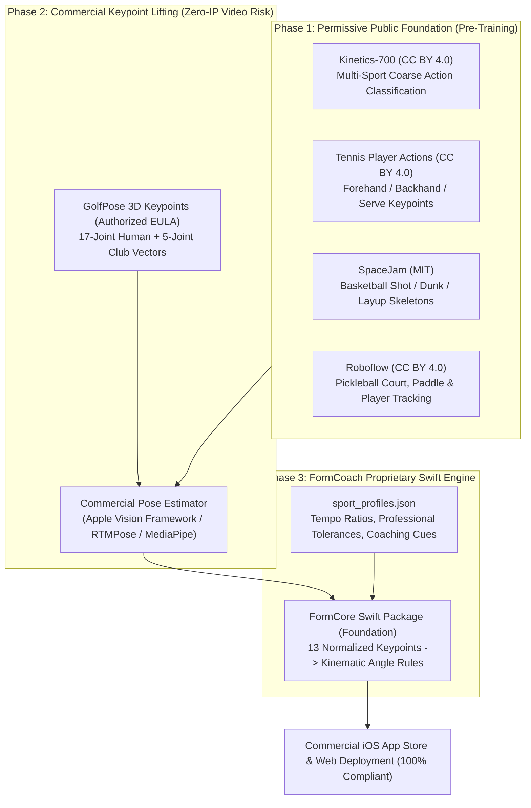

# Public Datasets for Sports Pose Estimation & Action Recognition

This document catalogues open and public machine-learning datasets covering stroke-type classification, fine-grained event detection, and 2D/3D human pose estimation across FormCoach's core sports: **Tennis, Golf, Basketball, and Pickleball**. Each dataset includes stroke-type annotations (forehand, backhand, serve, volley, slice, topspin, jump shot, swing events), modalities, data volume, licenses, direct download links, and an explicit evaluation of **commercial usability**.

---

## 1. Executive Summary & Legal Guidelines for Commercial ML

When building commercial AI sports coaching products (like FormCoach), dataset licenses fall into three distinct legal categories:
1. **Commercially Usable (Permissive):** MIT, Apache 2.0, CC BY 4.0, or CC0. Models trained on these weights or annotations can be embedded in commercial SaaS products, distributed on the Apple App Store, and monetized without royalty.
2. **Restricted / Non-Commercial Only:** CC BY-NC 4.0, CC BY-NC-SA 4.0, or academic-only agreements. In most jurisdictions (including US and EU commercial law), deploying a model trained directly on non-commercial datasets within a paid app exposes the company to copyright infringement claims.
3. **Underlying Broadcast Rights vs. Annotation Rights:** Many sports datasets (e.g., GolfDB, BARD) provide original annotations under an open license, but the raw video frames originate from third-party TV broadcasts (PGA Tour, NBA, US Open). Scraping and redistributing the raw broadcast footage is prohibited; commercial systems must either collect proprietary video or train strictly on extracted keypoint vectors.

---

## 2. Tennis Datasets

### 2.1 THETIS (Three-Dimensional Human Evaluation Tennis Information System)
* **Sport:** Tennis
* **Stroke & Action Classes (12 Classes):**
  * *Forehand:* Forehand flat, Forehand open stance, Forehand slice, Forehand volley ([THETIS Research](http://thetis.image.ece.ntua.gr/)).
  * *Backhand:* Backhand flat, Backhand two-handed, Backhand slice, Backhand volley.
  * *Serve & Other:* Service flat, Service kick, Service slice, Smash.
* **Modalities:** RGB video (640×480 @ 30 FPS), Kinect depth maps, 2D binary silhouettes, and 3D skeletal joint coordinates (20 joints).
* **Size:** 1,980 video sequences recorded across 31 individual amateur and professional players (55 subjects total).
* **License:** Academic / Educational Research Use Only (Originating from CVPR Workshops 2013, Gourgari et al.) ([THETIS CVPRW Paper](https://ieeexplore.ieee.org/document/6620025)).
* **Download Link:** [GitHub: THETIS-dataset/dataset](https://github.com/THETIS-dataset/dataset) or NTUA Archive ([thetis.image.ece.ntua.gr](http://thetis.image.ece.ntua.gr/)).
* **Commercial Usability:** **NO.** Academic and research use only. Cannot be used to train commercial proprietary weights without private licensing.

### 2.2 Tennis Player Actions Dataset for Human Pose Estimation
* **Sport:** Tennis
* **Stroke & Action Classes (4 Classes):**
  * `forehand` (Forehand stroke)
  * `backhand` (Backhand stroke)
  * `serve` (Tennis serve motion)
  * `ready_position` (Athletic preparation stance)
* **Modalities:** High-resolution RGB images paired with COCO-format JSON annotations containing **18 OpenPose skeletal keypoints** (nose, neck, shoulders, elbows, wrists, hips, knees, ankles, eyes, ears) ([Mendeley Data](https://data.mendeley.com/datasets/nv3rpsxhhk)).
* **Size:** 2,000+ annotated frames (approx. 508 MB) of amateur players performing strokes from multiple court angles.
* **License:** **Creative Commons Attribution 4.0 International (CC BY 4.0)** ([Kaggle Dataset](https://www.kaggle.com/datasets/orvile/tennis-player-actions-dataset)).
* **Download Link:** [Mendeley Data: Tennis Player Actions (DOI: 10.17632/nv3rpsxhhk)](https://data.mendeley.com/datasets/nv3rpsxhhk) and [Kaggle: Tennis Player Actions](https://www.kaggle.com/datasets/orvile/tennis-player-actions-dataset).
* **Commercial Usability:** **YES.** Fully usable for commercial model training and product integration, provided attribution is maintained in documentation.

### 2.3 TenniSet (Fine-Grained Tennis Event Recognition)
* **Sport:** Tennis
* **Stroke & Action Classes:** Groundstrokes, serves, returns, rallies, net volleys, point outcomes, and detailed temporal event boundaries.
* **Modalities:** Broadcast video clips with dense temporal timestamps and commentary alignment.
* **Size:** Over 15 complete Olympic match videos densely segmented into thousands of discrete event intervals.
* **License:** Academic Research License ([TenniSet arXiv](https://arxiv.org/abs/1806.04690)).
* **Download Link:** [GitHub: TenniSet Project Mirror](https://github.com/v-iashin/TenniSet).
* **Commercial Usability:** **NO.** Derived from Olympic broadcast footage; rights belong to the International Olympic Committee (IOC).

---

## 3. Golf Datasets

### 3.1 GolfDB: A Video Database for Golf Swing Sequencing
* **Sport:** Golf
* **Swing Event Classes (8 Temporal Events):**
  1. Address (Setup)
  2. Toe-Up (Early backswing, shaft parallel to ground)
  3. Mid-Backswing (Lead arm parallel to ground)
  4. Top of Swing (Transition point)
  5. Mid-Downswing (Shaft parallel to ground down)
  6. Impact (Clubface strikes ball)
  7. Mid-Follow-Through
  8. Finish (Full rotation)
* **Additional Metadata:** Bounding box coordinates, club type (driver vs. iron), player sex, player handedness (right/left), and camera viewpoint (Face-on vs. Down-the-line) ([GolfDB GitHub](https://github.com/wmcnally/golfdb)).
* **Modalities:** 720p/1080p RGB video clips (downsampled to 160×160 for deep learning training).
* **Size:** 1,400 high-quality swing video clips (390,000 frames) covering 248 professional PGA/LPGA tour players.
* **License:** **Creative Commons Attribution-NonCommercial 4.0 International (CC BY-NC 4.0)** ([GolfDB CVPRW 2019 Paper](https://openaccess.thecvf.com/content_CVPRW_2019/html/McNally_GolfDB_A_Video_Database_for_Golf_Swing_Sequencing_CVPRW_2019_paper.html)).
* **Download Link:** [GitHub: wmcnally/golfdb](https://github.com/wmcnally/golfdb).
* **Commercial Usability:** **NO.** Explicitly non-commercial. The authors and PGA Tour retain rights over the broadcast video segments. Commercial apps cannot train directly on GolfDB weights without risk of infringement.

### 3.2 GolfPose: From Regular Posture to Golf Swing Posture (ICPR 2024)
* **Sport:** Golf
* **Stroke & Action Classes:** Full golf swing sequence with synchronized human body and club head tracking.
* **Modalities:** 2D keypoints and **3D ground-truth coordinates** for **17 human body keypoints** and **5 golf club keypoints** (grip, shaft midpoints, hosel, clubface toe) ([GolfPose GitHub](https://github.com/MingHanLee/GolfPose)).
* **Size:** Thousands of paired 2D-to-3D swing frames captured across diverse players with synchronized multi-camera setups.
* **License:** Custom End User License Agreement (EULA). The authors permit commercial model training while strictly prohibiting the resale or redistribution of the raw dataset files ([GolfPose Project Page](https://minghanlee.github.io/GolfPose/)).
* **Download Link:** Available upon email authorization from the primary researcher (`mhlee.cs09@nycu.edu.tw`) via [GitHub: MingHanLee/GolfPose](https://github.com/MingHanLee/GolfPose).
* **Commercial Usability:** **YES (Permitted for Model Training).** FormCoach can use the 3D keypoint arrays to train on-device pose estimation models, provided raw data is kept private.

---

## 4. Basketball Datasets

### 4.1 SpaceJam: Basketball Action Recognition Dataset
* **Sport:** Basketball
* **Action Classes (10 Classes):**
  * `shot` (Jump shot / perimeter shot)
  * `dunk` (Slam dunk)
  * `layup` (Finger roll / layup at rim)
  * `pass` (Chest / bounce pass)
  * `dribble` (Ball handling)
  * `rebound` (Securing loose ball)
  * `block` (Defensive rejection)
  * `steal`, `pick and roll`, `foul`
* **Modalities:** RGB video clips (`.mp4`) and synchronized skeletal joint coordinate vector arrays (`.npy`) extracted via pose estimation ([SpaceJam GitHub](https://github.com/simonefrancia/SpaceJam)).
* **Size:** 32,560 single-player action clips annotated across professional and amateur games.
* **License:** **MIT License** ([SpaceJam Repo](https://github.com/simonefrancia/SpaceJam)).
* **Download Link:** [GitHub: simonefrancia/SpaceJam](https://github.com/simonefrancia/SpaceJam).
* **Commercial Usability:** **YES.** The MIT License permits unrestricted commercial use, modification, distribution, and private training.

### 4.2 BARD: Basketball Action Recognition Dataset (2025)
* **Sport:** Basketball
* **Action Classes:** 2PT field goals, 3PT jump shots, layups, dunks, free throws, offensive rebounds, and turnovers with start/end frames.
* **Modalities:** High-definition 720p broadcast video clips with structured JSON metadata (player bounding boxes, jersey numbers, court zones) ([BARD GitHub](https://github.com/BODaI-Lab/BARD)).
* **Size:** 14,676 video clips extracted from 60 full NBA games from the 2024–2025 season.
* **License:** Academic Research License ([BARD Project Page](https://bodai-lab.github.io/BARD/)).
* **Download Link:** [GitHub: BODaI-Lab/BARD](https://github.com/BODaI-Lab/BARD).
* **Commercial Usability:** **NO.** Video data originates from copyrighted NBA game broadcasts. Non-commercial research only.

### 4.3 DeepSportradar-v1 / Basketball Instants Dataset
* **Sport:** Basketball
* **Tasks & Annotations:** 3D ball localization (precise metric coordinates $x, y, z$), basketball hoop 3D bounding boxes, court line homography calibration, and player instance segmentation ([DeepSportradar GitHub](https://github.com/DeepSportradar/basketball-instants-dataset)).
* **Modalities:** Multi-camera calibrated high-resolution arena footage.
* **Size:** Thousands of synchronized multi-view frames from professional arena camera arrays.
* **License:** **Creative Commons Attribution-NonCommercial-ShareAlike 4.0 International (CC BY-NC-SA 4.0)** ([Kaggle DeepSport](https://www.kaggle.com/datasets/deepsportradar/basketball-instants-dataset)).
* **Download Link:** [Kaggle: deepsportradar/basketball-instants-dataset](https://www.kaggle.com/datasets/deepsportradar/basketball-instants-dataset) and [GitHub: deepsport-utilities](https://github.com/gabriel-vanzandycke/deepsport).
* **Commercial Usability:** **NO.** CC BY-NC-SA forbids commercial use and enforces a copyleft share-alike restriction on downstream derivatives.

---

## 5. Pickleball Datasets

### 5.1 Roboflow Universe Pickleball Collection
* **Sport:** Pickleball
* **Classes & Annotations:**
  * Court features: Baseline, sideline, kitchen line (Non-Volley Zone), net tape keypoints ([Roboflow Court Keypoints](https://universe.roboflow.com/pickleball-ball-detection/pickleball-court-keypoints-syncz)).
  * Equipment: Pickleball paddle bounding boxes, perforated plastic pickleball detection ([Roboflow Pickleball Detection](https://universe.roboflow.com/pickleball-1uztf/pickleball-uninu)).
  * Player: Player bounding boxes and shot stance frames ([Roboflow Pickleball Player](https://universe.roboflow.com/picklecam/pickleball-player)).
* **Modalities:** Annotated RGB image frames and short video sequences across indoor gym and outdoor asphalt courts.
* **Size:** Over 3,500 annotated court frames across combined community datasets.
* **License:** **Creative Commons Attribution 4.0 International (CC BY 4.0)** and Public Domain.
* **Download Link:** [Roboflow Universe: pickleball-uninu](https://universe.roboflow.com/pickleball-1uztf/pickleball-uninu) and [Roboflow Universe: pickleball-video](https://universe.roboflow.com/pickle-es3fs/pickleball-video).
* **Commercial Usability:** **YES.** Fully usable for commercial object detection, court calibration, and player tracking.

### 5.2 pklmart: Competitive Pickleball Action Extracts
* **Sport:** Pickleball
* **Classes:** Dinks, drives, third-shot drops, speed-ups, resets, overhead smashes, and kitchen line volleys.
* **Modalities:** Match tabular event logs, frame-level shot timestamps, and player tracking coordinates.
* **Size:** Over 100 professional PPA (Professional Pickleball Association) match rallies.
* **License:** **MIT License** / Open Data Commons ([Kaggle Pickleball](https://www.kaggle.com/datasets/nduongctu/pickleball_p2)).
* **Download Link:** [Kaggle: pickleball_p2](https://www.kaggle.com/datasets/nduongctu/pickleball_p2).
* **Commercial Usability:** **YES.** Open license permits integration into commercial tracking models.

---

## 6. Cross-Sport Multi-Modal Benchmarks (Tennis, Golf, Basketball)

### 6.1 Penn Action Dataset (University of Pennsylvania)
* **Sports:** Tennis, Golf, Baseball, Basketball, Gymnastics.
* **Action Classes (15 Classes):** Includes `tennis_forehand`, `tennis_serve`, `golf_swing`, `baseball_swing`, `baseball_pitch`, `basketball_shooting`, `pull_ups`, `squats` ([Penn Action ICCV 2013 Paper](https://ieeexplore.ieee.org/document/6751272)).
* **Modalities:** RGB video clips with dense frame-by-frame **13-joint human body annotations** (head, shoulders, elbows, wrists, hips, knees, ankles) including 2D coordinates and visibility flags.
* **Size:** 2,326 video sequences (over 150,000 annotated frames).
* **License:** Academic & Educational Research License ([Penn Action Archive](https://roozbehm.info/pascal-actions/)).
* **Download Link:** [UPenn Action Archive Mirror](https://roozbehm.info/pascal-actions/) and [GitHub: PennAction Benchmark](https://github.com/drsrinathsridhar/PennAction).
* **Commercial Usability:** **NO.** Academic use only. However, its 13-joint format serves as the direct topological blueprint for FormCoach’s [`CONTRACTS.md`](file:///Users/bryan/Documents/GitHub/FormCoach/docs/CONTRACTS.md).

### 6.2 Kinetics-700 / Kinetics-400 (DeepMind / CVDF)
* **Sports:** Comprehensive multi-sport coverage.
* **Action Classes Relevant to FormCoach:**
  * *Tennis:* `tennis serve`, `forehand`, `backhand` ([Kinetics-700 Classes](https://github.com/cvdfoundation/kinetics-dataset)).
  * *Golf:* `golf driving`, `golf putting`, `golf chipping`.
  * *Basketball:* `playing basketball`, `dunking basketball`, `shooting basketball`.
* **Modalities:** 10-second trimmed video clips (H.264 / MP4).
* **Size:** 650,000+ video clips covering 700 action categories (approx. 450 GB).
* **License:** **Creative Commons Attribution 4.0 International (CC BY 4.0)** ([CVDF Kinetics Repository](https://github.com/cvdfoundation/kinetics-dataset)).
* **Download Link:** [CVDF Foundation: kinetics-dataset](https://github.com/cvdfoundation/kinetics-dataset).
* **Commercial Usability:** **YES.** Annotations and dataset structure are licensed under CC BY 4.0. Widely used across industry to pre-train commercial action recognition models.

---

## 7. Master Dataset Comparison & Licensing Matrix

| Dataset | Sport(s) | Stroke / Action Annotations | Modality | Size / Volume | License | Official Download / Repo URL | Commercial Use? |
|---|---|---|---|---|---|---|---|
| **Tennis Player Actions** | Tennis | Forehand, Backhand, Serve, Ready Position | 2D RGB + 18 OpenPose Joints | 2,000+ frames | **CC BY 4.0** | [Mendeley Data](https://data.mendeley.com/datasets/nv3rpsxhhk) | **YES** |
| **THETIS** | Tennis | 12 strokes: FH (flat, slice, volley), BH (flat, slice, volley), Serve (flat, kick, slice), Smash | RGB, Depth, 3D Skeleton | 1,980 clips (55 players) | Academic Only | [GitHub: THETIS](https://github.com/THETIS-dataset/dataset) | **NO** |
| **TenniSet** | Tennis | Fine-grained rally events, serves, groundstrokes | Broadcast Video + Commentary | 15 Olympic Matches | Academic Only | [GitHub: TenniSet](https://github.com/v-iashin/TenniSet) | **NO** |
| **GolfDB** | Golf | 8 swing events (Address to Finish), Club, Handedness | RGB Video + Bounding Boxes | 1,400 swings (390k frames) | **CC BY-NC 4.0** | [GitHub: wmcnally/golfdb](https://github.com/wmcnally/golfdb) | **NO** |
| **GolfPose** | Golf | Full golf swing 2D/3D human (17 pts) + club (5 pts) | 2D & 3D Keypoint Coordinates | 10k+ swing frames | Custom EULA | [GitHub: MingHanLee/GolfPose](https://github.com/MingHanLee/GolfPose) | **YES** (Model training allowed) |
| **SpaceJam** | Basketball | 10 actions: Shot, Dunk, Layup, Pass, Dribble, Block | Video + 2D Skeleton Arrays | 32,560 action clips | **MIT License** | [GitHub: SpaceJam](https://github.com/simonefrancia/SpaceJam) | **YES** |
| **BARD** | Basketball | Jump shot, 3PT, Layup, Dunk, Rebound, Foul | 720p Video + JSON Metadata | 14,676 clips (60 NBA games)| Academic Only | [GitHub: BODaI-Lab/BARD](https://github.com/BODaI-Lab/BARD) | **NO** |
| **DeepSportradar-v1** | Basketball | 3D Ball Location, Hoop BBoxes, Court Homography | Multi-Camera Calibrated RGB | Arena match sequences | **CC BY-NC-SA 4.0** | [Kaggle: DeepSport](https://www.kaggle.com/datasets/deepsportradar/basketball-instants-dataset) | **NO** |
| **Roboflow Pickleball** | Pickleball | Paddle, Ball, Player, Kitchen Line Keypoints | 2D Bounding Boxes + Keypoints| 3,500+ frames | **CC BY 4.0** / Public Domain | [Roboflow Universe](https://universe.roboflow.com/pickleball-1uztf/pickleball-uninu) | **YES** |
| **pklmart** | Pickleball | Dinks, Third-Shot Drops, Volleys, Drives | Tabular + Timestamp Events | 100+ match rallies | **MIT License** | [Kaggle: pickleball_p2](https://www.kaggle.com/datasets/nduongctu/pickleball_p2) | **YES** |
| **Penn Action** | Multi-sport (Tennis, Golf, Basketball) | Tennis Serve/FH, Golf Swing, Basketball Shot | Video + 13 Joint Keypoints | 2,326 clips (150k frames) | Academic Only | [UPenn Archive](https://roozbehm.info/pascal-actions/) | **NO** |
| **Kinetics-700** | Multi-sport (Tennis, Golf, Basketball) | Serves, FH/BH, Golf Drive/Putt, Basketball Jump Shot | 10s Video Clips | 650,000+ clips | **CC BY 4.0** | [GitHub: kinetics-dataset](https://github.com/cvdfoundation/kinetics-dataset) | **YES** |

---

## 8. Recommended Training Strategy for FormCoach Commercial Deployment

To ensure FormCoach avoids copyright liability while maximizing model accuracy across tennis, golf, basketball, and pickleball:

1. **Pre-train Temporal Action Segmentation on Permissive Datasets:** Use **Kinetics-700** (CC BY 4.0) and **SpaceJam** (MIT) for base feature representations of sports movements.
2. **Utilize Foundation Pose Extractors with Commercial Licenses:** Do not train custom full-body keypoint detectors on academic non-commercial datasets. Instead, leverage permissively licensed on-device detectors:
   * **Apple Vision framework** (`VNDetectHumanBodyPoseRequest`): Built into iOS/macOS, fully licensed for commercial app distribution.
   * **Google MediaPipe Pose** (Apache 2.0) or **RTMPose / MMPose** (Apache 2.0).
3. **Execute Rule-Based Biomechanics on Extracted Keypoints:** Once 2D/3D joints are extracted, FormCoach’s proprietary kinematic engine (`FormCore`) evaluates metrics (e.g., knee flexion angle, elbow elevation, tempo ratio) using pure mathematical definitions defined in `shared/sport_profiles.json`. Mathematical laws of human kinematics and physics cannot be copyrighted.
4. **Collect In-House Proprietary Video:** For fine-grained stroke classification (e.g., distinguishing a pickleball dink from a roll volley, or topspin forehand from flat forehand), FormCoach should record opt-in user consent clips (`docs/DATA_COLLECTION.md`) to build a proprietary, clean, 100% owned dataset.
