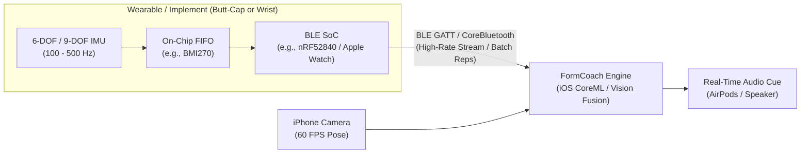
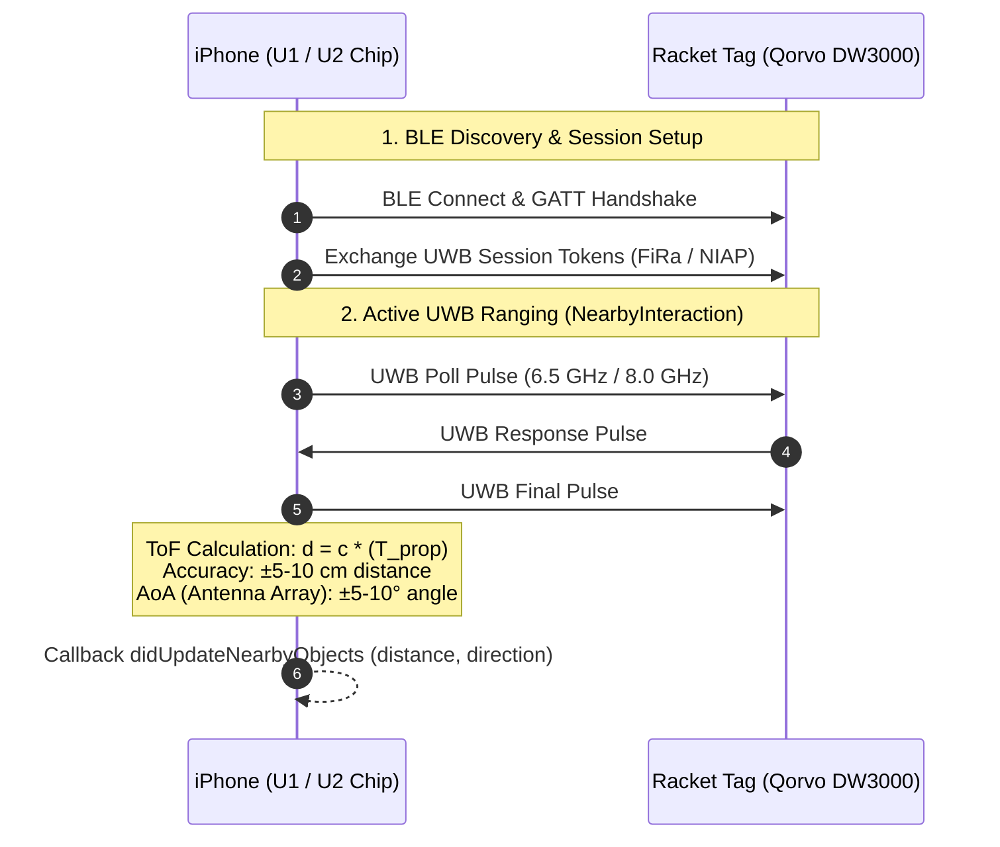
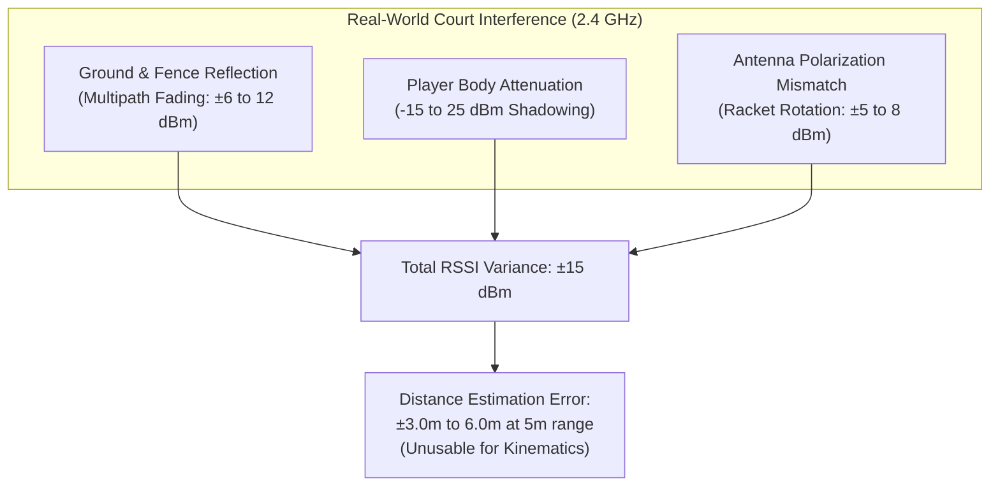
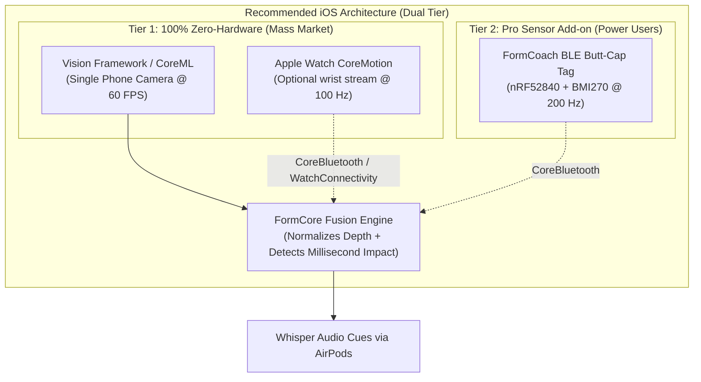
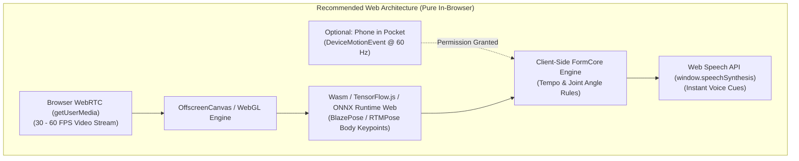

# Wearables, Spatial Positioning & Browser Sensing for FormCoach

This document evaluates hardware, wireless ranging, and wearable sensor options to augment FormCoach’s single-camera computer-vision pipeline. It analyzes how to locate the player, racket, or club relative to the phone, or add high-frequency inertial motion detail (sub-video rotational kinematics, impact timestamps, and tempo), covers browser-based limitations (notably iOS Safari), and concludes with concrete recommendations for native iOS and Web architectures.

---

## 1. System Objectives & Problem Statement

FormCoach currently tracks a 13-joint skeletal model from monocular video ([CONTRACTS.md](file:///Users/bryan/Documents/GitHub/FormCoach/docs/CONTRACTS.md)). Monocular video has two fundamental physical limits:
1. **Depth Ambiguity (Spatial Distance to Camera):** A single 2D camera cannot directly measure metric distance ($Z$-axis) without known reference objects or court calibration lines.
2. **Temporal Resolution (Impact & Fast Rotation):** A tennis racket traveling at 110 mph moves ~1.6 feet between frames at 60 FPS (or 5 inches at 240 FPS). The impact duration between ball and strings is only ~4–6 milliseconds—often completely lost between video frames.

To bridge these gaps, supplementary wireless and inertial modalities can either:
* **Locate the player/implement spatially:** Measure distance ($d$) and angle ($\theta$) relative to the phone.
* **Capture high-rate kinematics:** Provide 100–500 Hz angular velocity, acceleration spikes (impact), and rotational quaternions.

---

## 2. BLE Wristbands & IMU Sensors

Inertial Measurement Units (IMUs) combining a 3-axis accelerometer and 3-axis gyroscope (6-DOF) or magnetometer (9-DOF) can measure angular velocities exceeding 2,000°/s and linear accelerations exceeding 16g.



### 2.1 Low-Cost Custom/OEM BLE Modules (Nordic nRF52 Series)
* **Hardware Profile:** Nordic Semiconductor [nRF52840](https://www.nordicsemi.com/products/nrf52840) or [nRF52832](https://www.nordicsemi.com/products/nrf52832) paired with a modern low-power 6-DOF IMU (e.g., Bosch [BMI270](https://www.bosch-sensortec.com/products/motion-sensors/imu/bmi270/) or TDK InvenSense ICM-42688-P) and a CR2032 coin cell or 150 mAh rechargeable LiPo.
* **Prototyping Off-The-Shelf Boards:** [Seeed Studio XIAO BLE Sense](https://www.seeedstudio.com/Seeed-XIAO-BLE-Sense-nRF52840-p-5253.html) ($15.99 retail) integrates an nRF52840 and 6-axis IMU in a 21×17.5 mm thumb-sized footprint weighing under 5 grams.
* **Sampling Rate & Bandwidth:** Can sample the IMU at 200–400 Hz locally. BLE 5.0 2M PHY throughput allows streaming raw 6-axis data (12 bytes per sample $\times$ 200 Hz = 2.4 kB/s) with minimal packet loss.
* **Battery Life:** 150 mAh LiPo provides 18–30 hours of continuous high-rate streaming, or months in sleep mode with motion wake-up.
* **Bill of Materials (BOM) Cost:**
  * In volume (1,000–5,000 units): nRF52832 SoC ($1.80) + BMI270 ($1.20) + PCB & passives ($1.50) + Battery ($1.20) + Injection molded silicone/polycarbonate racket butt-cap strap ($2.50) = **$8.20–$14.50 BOM**.
  * Retail target: $39–$59.
* **Kinematic Accuracy:** Bosch BMI270 angular velocity noise density is $0.008\text{ dps}/\sqrt{\text{Hz}}$, yielding orientation drift $<0.5^\circ$ over a 3-second athletic rep.

### 2.2 Movesense ([movesense.com](https://www.movesense.com/))
* **Hardware:** [Movesense Active](https://www.movesense.com/product/movesense-active/) and [Movesense Flash](https://www.movesense.com/product/movesense-flash/) (~€89–€119 / ~$95–$130 per unit).
* **Capabilities:** 9-DOF IMU (accelerometer configurable up to ±16g, gyroscope up to ±2000°/s, magnetometer), single-channel ECG/heart rate, and onboard flash memory (Flash model stores up to 128 MB of movement data if disconnected).
* **Sampling Rate:** Accelerometer up to 833 Hz; gyroscope up to 416 Hz.
* **SDK & Integration:** Provides open, official iOS and Android native SDKs (`Movesense-device-lib`) communicating via BLE GATT using REST-style API calls (`/Meas/Acc/52`, `/Meas/Gyro/104`) ([Movesense GitHub](https://github.com/movesense/movesense-device-lib)).
* **Evaluation:** Superb turnkey development device for validation, but too bulky (diameter 36.6 mm, thickness 10.6 mm, weight 9.4g) and costly for direct mass-market consumer bundling.

### 2.3 Polar SDK & Sensors ([polar.com](https://www.polar.com/))
* **Hardware:** [Polar Verity Sense](https://www.polar.com/us-en/products/accessories/polar-verity-sense-optical-heart-rate-sensor) ($99.95 retail) optical heart rate sensor + 3D accelerometer / gyroscope / magnetometer.
* **API & Streaming:** Open [Polar BLE SDK](https://github.com/polarofficial/polar-ble-sdk) for iOS and Android. Supports streaming raw accelerometer data at 52 Hz or 208 Hz (depending on firmware mode) and raw gyroscope data at 208 Hz.
* **Limitations:** Armband / temple clip form factor designed primarily for endurance training and heart rate rather than high-g impact detection (>16g shocks saturate the sensor).

### 2.4 Apple Watch CoreMotion ([developer.apple.com](https://developer.apple.com/documentation/coremotion))
* **Capabilities:** Apple Watch Series 4 and newer contain high-performance custom IMUs accessible via Apple’s [`CMMotionManager`](https://developer.apple.com/documentation/coremotion/cmmotionmanager) and [`CMDeviceMotion`](https://developer.apple.com/documentation/coremotion/cmdevicemotion).
* **Sampling Rate:** Standard motion updates support up to 100 Hz (`startDeviceMotionUpdates`). In watchOS 8+, background workout sessions with [`WKExtendedRuntimeSession`](https://developer.apple.com/documentation/watchkit/wkextendedruntimesession) or high-frequency updates can reach up to 100–200 Hz.
* **Metrics Provided:**
  * `attitude`: Device orientation as a quaternion ($w, x, y, z$) or Euler angles relative to calibrated reference frames (`xArbitraryCorrectedZVertical`).
  * `rotationRate`: Bias-corrected 3D angular velocity in radians/second.
  * `userAcceleration`: 3D acceleration with Earth's gravity subtracted ($1g \approx 9.81\text{ m/s}^2$).
* **Incremental Hardware Cost:** **$0** (if the user already owns an Apple Watch; 100M+ active users globally).
* **Accuracy:** Industrial-grade sensor fusion running on Apple’s S-series chip; drift is continuously corrected using sensor fusion algorithms.
* **Limitations:**
  * Worn on the wrist, not the implement (racket/club). It captures arm swing and wrist rotation, but cannot directly measure racket face twist or sweet spot impact without geometric forward kinematics.
  * Rapid wrist flexing during tennis forehands or golf swings can trigger the Digital Crown or Emergency SOS unless orientation is inverted in watchOS settings ([Reddit r/golf: Crown Press](https://www.reddit.com/r/golf/comments/16z3vkm/apple_watch_accidental_crown_press_golf_swing/)).

### 2.5 WearOS (Android)
* **API:** Android [`SensorManager`](https://developer.android.com/reference/android/hardware/SensorManager) accessing `TYPE_ACCELEROMETER`, `TYPE_GYROSCOPE`, and `TYPE_ROTATION_VECTOR` at `SENSOR_DELAY_FASTEST` (typically 100 Hz, hardware-dependent).
* **Limitations:** Severe fragmentation across OEM hardware (Samsung Galaxy Watch, Google Pixel Watch, Mobvoi TicWatch). Sensor batching policies frequently delay real-time streaming to conserve battery unless a dedicated foreground service holds a partial wake lock.

---

## 3. Ultra-Wideband (UWB) Spatial Positioning

Ultra-Wideband (UWB) operates across 3.1 to 10.6 GHz (specifically Channels 5 and 9 at 6.5 GHz and 8.0 GHz for Apple devices), utilizing nanosecond pulses to perform Two-Way Ranging (TWR) using Time-of-Flight (ToF).



### 3.1 Apple U1 vs. U2 Chip & NearbyInteraction Framework
* **Framework:** Apple’s [NearbyInteraction](https://developer.apple.com/documentation/nearbyinteraction) framework enables an iPhone to range against another Apple device (`NINearbyPeerConfiguration`) or a certified third-party accessory (`NINearbyAccessoryConfiguration`).
* **Hardware Chips:**
  * **U1 Chip:** Introduced in iPhone 11 through iPhone 14 lineups.
  * **U2 Chip:** Introduced in iPhone 15, iPhone 16 lineups, Apple Watch Series 9, and Apple Watch Ultra 2 ([Apple UWB Overview](https://developer.apple.com/documentation/nearbyinteraction)).
* **Spatial Measurements Delivered:**
  * `distance`: Scalar Euclidean distance in meters down to centimeter precision ([Apple NearbyObject](https://developer.apple.com/documentation/nearbyinteraction/ninearbyobject)).
  * `direction`: 3D unit vector (`simd_float3` representing azimuth and elevation) relative to the iPhone camera axis.
* **U1 vs. U2 Implementation Nuances:**
  * Third-party developers using `NINearbyAccessoryConfiguration` have documented that while U1 devices reliably return a 3D `direction` vector, U2 devices may return `direction = nil` with certain third-party accessory firmware profiles, falling back to distance-only ranging unless the accessory strictly complies with Apple's latest Nearby Interaction Accessory Protocol (NIAP) revision ([Apple Developer Forums: U2 Direction Bug](https://developer.apple.com/forums/thread/739194)).
  * Always verify capabilities programmatically via [`NISession.deviceCapabilities.supportsDirectionMeasurement`](https://developer.apple.com/documentation/nearbyinteraction/nidevicecapabilities/supportsmeasurement(for:)).

### 3.2 Third-Party UWB Modules & Standards
Apple NearbyInteraction adheres to the **FiRa Consortium** and IEEE 802.15.4z standards ([FiRa Consortium](https://www.firaconsortium.org/)). Supported commercially available UWB transceivers:
1. **Qorvo / Decawave DW3000 Series ([Qorvo DWM3001CDK](https://www.qorvo.com/products/p/DWM3001CDK)):** Pre-certified development kit integrating DW3110 UWB transceiver, Nordic nRF52833 BLE SoC, and integrated planar antenna ($45–$55 retail). Fully compatible with Apple NearbyInteraction example code.
2. **NXP Trimension SR040 / SR150 ([NXP SR150](https://www.nxp.com/products/wireless-connectivity/ultra-wideband-uwb/trimension-sr150)):** Designed specifically for IoT tags and smart accessories with integrated FiRa-compliant firmware.

### 3.3 UWB Accuracy & Performance Metrics
* **Line-of-Sight (LOS) Distance Accuracy:** **±5 to 10 cm** at distances from 0.5 meters to 25 meters.
* **Angle of Arrival (AoA) Directional Accuracy:** **±5° to 10°** in azimuth and elevation when the phone is oriented toward the accessory within a ±60° field of view.
* **Camera Assistance:** In iOS 16+, `isCameraAssistanceEnabled = true` blends visual feature tracking (ARKit) with UWB radio signals, reducing directional error to <3° ([Apple NIConfiguration](https://developer.apple.com/documentation/nearbyinteraction/niconfiguration)).

### 3.4 Critical Limitations in Sports Environments
* **Human Body Shadowing & Water Attenuation:** The human body is composed of ~60% water, which heavily absorbs 6–8 GHz RF energy. If a player turns their back to the phone camera during a golf backswing or tennis unit turn, the player's torso blocks direct line of sight. Non-Line-of-Sight (NLOS) conditions introduce positive bias (+30–100 cm error) or cause packet dropouts ([IEEE Papers on UWB Body Shadowing](https://ieeexplore.ieee.org/document/8377317)).
* **Power Consumption:** UWB requires peak transmit currents of 30–50 mA during active packet exchange (compared to <5 mA for BLE). A small coin cell (CR2032) cannot sustain 20 Hz UWB ranging without rapid voltage collapse; a rechargeable LiPo (150+ mAh) is mandatory.
* **Cost:** UWB transceiver modules (DW3000) cost ~$8–$12 at scale (vs. $1.50 for a BLE-only SoC), pushing tag retail prices to $69–$99.

---

## 4. BLE RSSI Ranging Accuracy & Feasibility

Received Signal Strength Indicator (RSSI) measures the power of a received radio signal in decibels relative to one milliwatt (dBm).

### 4.1 Theoretical Path Loss Model
Distance estimation via RSSI relies on the log-distance path loss model:

$$RSSI = -10n \log_{10}(d) + A$$

Where:
* $d$: Distance between transmitter and receiver (meters).
* $n$: Path loss exponent (typically $2.0$ in open air, $2.5–3.5$ on sports courts).
* $A$: Calibrated RSSI at 1 meter distance (typically $-58$ to $-65\text{ dBm}$).

Solving for distance:

$$d = 10^{\frac{A - RSSI}{10n}}$$



### 4.2 Real-World Sources of Error on Athletic Courts
1. **Multipath Fading:** Radio waves bounce off asphalt/clay surfaces, concrete fences, and metal chain-link fencing, creating constructive and destructive interference patterns. Even moving the racket 5 centimeters can alter RSSI by 8 dBm.
2. **Body Shadowing:** The human body attenuates 2.4 GHz signals by **15 to 30 dB**. If the user hits a backhand where their body is between the racket butt-cap and the phone, RSSI plummets instantly—tricking the path loss equation into calculating that the player moved 10 meters further away.
3. **Antenna Polarization:** As the player swings, the racket rotates through 3D space, changing the relative polarization between transmitter and receiver antennas and causing up to 10 dB fluctuations unrelated to distance.

### 4.3 Practical Accuracy Numbers
* **At 1–3 meters:** Error is **±1.5 to 2.5 meters**.
* **At 3–8 meters:** Error is **±3.0 to 6.0 meters**.
* **Conclusion for FormCoach:** **BLE RSSI is mathematically incapable of tracking racket/club kinematics or player depth.** It is strictly suitable for coarse 3-tier proximity classification:
  * *Immediate* ($<0.5\text{ m}$): Phone is being held.
  * *Near* ($1–4\text{ m}$): Player is in the camera framing box.
  * *Far* ($>5\text{ m}$): Player is across the court.

### 4.4 Emerging Alternatives: BLE 5.1 AoA and Bluetooth 6.0 Channel Sounding
* **BLE 5.1 Direction Finding (AoA/AoD):** Requires antenna arrays (3–4 antennas) on the receiver to measure phase differences ([Bluetooth SIG AoA](https://www.bluetooth.com/learn-about-bluetooth/feature-enhancements/direction-finding/)). Standard iPhones and Android smartphones **do not have antenna arrays**; this requires expensive proprietary gateway hardware.
* **Bluetooth 6.0 Channel Sounding (PBR):** Adopted in late 2024, Phase-Based Ranging (PBR) and Round-Trip Timing (RTT) promise 10–30 cm accuracy without UWB ([Bluetooth SIG Channel Sounding](https://www.bluetooth.com/bluetooth-resources/bluetooth-channel-sounding/)). However, commercial smartphone silicon adopting BT 6.0 will only reach widespread consumer penetration around 2026–2027.

---

## 5. What Works from a BROWSER: Web API Audit

For a zero-install Web application (`docs/WEB_DEMO.md`), browser hardware access is strictly sandboxed.

### 5.1 Web Bluetooth API (`navigator.bluetooth`)
* **Specification:** W3C [Web Bluetooth](https://webbluetoothcg.github.io/web-bluetooth/) allows web pages to discover, connect, and read/write GATT characteristics over BLE.
* **Browser Compatibility:**
  * **Google Chrome / Microsoft Edge / Opera (Desktop & Android):** **FULL SUPPORT** (Requires HTTPS and explicit user activation via gesture).
  * **Apple Safari (iOS & iPadOS):** **NO SUPPORT. STRICTLY BLOCKED.**
  * **Apple Safari (macOS):** **NO SUPPORT.**
  * **Third-Party Browsers on iOS (Chrome/Firefox/Brave on iOS):** **NO SUPPORT.** (Under Apple App Store guidelines, all iOS browsers were required to use Apple's WebKit rendering engine, which excludes Web Bluetooth).
* **The WebKit Stance:** Apple’s WebKit team has formally and repeatedly rejected implementing Web Bluetooth, citing unmitigated fingerprinting and persistent security risks where malicious websites could silently communicate with smart devices in the user's home ([WebKit Feature Status](https://webkit.org/status/), [WebKit Bug 163458](https://bugs.webkit.org/show_bug.cgi?id=163458)).
* **Workaround for iOS Web:** Requires users to download specialized third-party kiosk utility browsers like **Bluefy** ([bluefy.app](https://apps.apple.com/us/app/bluefy-web-ble-browser/id1492822055)) or **WebBLE**, which inject a custom JavaScript polyfill for `navigator.bluetooth`. This completely breaks the "zero-install frictionless link" value proposition for casual users.

### 5.2 Generic Sensor API
* **Specification:** W3C [Generic Sensor API](https://www.w3.org/TR/generic-sensor/) defines standard interfaces for `Accelerometer`, `Gyroscope`, `LinearAccelerationSensor`, `AbsoluteOrientationSensor`, and `RelativeOrientationSensor`.
* **Browser Compatibility:**
  * **Chromium (Chrome/Edge Android & Desktop):** Supported (Absolute Orientation requires flag or permission).
  * **Safari (iOS & macOS):** **NO SUPPORT.** Apple has not implemented the Generic Sensor API specification ([Can I Use: Generic Sensor](https://caniuse.com/generic-sensor-api)).

### 5.3 DeviceMotion & DeviceOrientation Events
* **Specification:** W3C [DeviceOrientation Event Specification](https://www.w3.org/TR/orientation-event/) exposing `window.ondevicemotion` and `window.ondeviceorientation`.
* **Browser Compatibility:** Supported across all major mobile browsers, **including iOS Safari** ([MDN: DeviceMotionEvent](https://developer.mozilla.org/en-US/docs/Web/API/DeviceMotionEvent)).
* **iOS Safari Permissions & Nuances:**
  * Since iOS 12.2 and solidified in iOS 14.5+, accessing motion sensors requires explicit user opt-in via a user gesture (e.g., tapping a "Start Drill" button) invoking:
    ```javascript
    if (typeof DeviceMotionEvent.requestPermission === 'function') {
      DeviceMotionEvent.requestPermission()
        .then(response => {
          if (response === 'granted') {
            window.addEventListener('devicemotion', handleMotion);
          }
        });
    }
    ```
* **Performance on iOS Safari:**
  * **Data Delivered:** `acceleration` ($x, y, z$), `accelerationIncludingGravity`, and `rotationRate` ($\alpha, \beta, \gamma$ in deg/sec).
  * **Sampling Rate:** Capped at **60 Hz** in iOS Safari (synchronized with display refresh).
  * **FormCoach Use Case:** Because the phone itself is the sensor, the user would have to place the phone in their pocket to measure hip turn/tempo, or strap it to their forearm. It cannot track an external racket or club.

### 5.4 Comprehensive Browser Capabilities Matrix

| API / Feature | Spec Authority | Chrome (Android/Desktop) | Safari (iOS / iPadOS) | Chrome / Firefox on iOS | Practical Sports Coaching Utility |
|---|---|---|---|---|---|
| **Web Bluetooth** (`navigator.bluetooth`) | W3C Community Group | Supported (GATT client) | **Blocked / Unsupported** ([WebKit Stance](https://webkit.org/status/)) | **Blocked** (WebKit forced) | Excellent for Android/PC; completely non-viable for general iOS web audience. |
| **Generic Sensor API** (`Gyroscope`, `LinearAcc`) | W3C Candidate Rec | Supported | **Blocked / Unsupported** | **Blocked** | Dead end on iOS web. |
| **DeviceMotionEvent** (`window.ondevicemotion`) | W3C Standard | Supported | Supported (Requires permission click) | Supported (Requires permission) | Useful for phone-in-pocket hip rotation & tempo (~60 Hz). |
| **MediaDevices Camera** (`getUserMedia`) | W3C Standard | Supported (Up to 60 FPS) | Supported (Up to 60 FPS in iOS Safari) | Supported | **Primary Foundation:** Browser-based computer vision (WebAssembly + WebGL / WebGPU). |

---

## 6. Recommendations & Architecture Paths

### 6.1 Recommended Path for Native iOS App



#### Primary Recommendation: Vision AI + Apple Watch CoreMotion (Zero Cost)
* **Core Rationale:** Eliminate hardware sales friction. Over 40% of iPhone-using tennis and golf players already own an Apple Watch.
* **Implementation:**
  * Use the iPhone camera for monocular 2D/3D joint pose estimation at 60 FPS via Apple's Vision framework (`VNDetectHumanBodyPoseRequest`).
  * Run a lightweight companion watchOS app streaming `CMDeviceMotion` at 100 Hz using `WKExtendedRuntimeSession`.
  * Fuse watch accelerometer spikes with camera pose to calculate exact swing start, peak arm speed, and ball impact timestamps down to 10 ms.
* **Cost per unit:** **$0** incremental BOM cost.
* **Accuracy:**
  * Joint position: ~1–3 cm pixel accuracy in 2D normalized frame.
  * Tempo ratio (backswing to downswing time): ±0.02 seconds accuracy.
  * Impact detection: ±10 milliseconds.

#### Secondary Hardware Option for Power Users: nRF52840 BLE Butt-Cap Tag
* **Hardware:** Custom silicone butt-cap sleeve holding an nRF52840 + Bosch BMI270 6-DOF IMU ($12 BOM, $49 retail).
* **Connection:** Connects directly via native iOS `CoreBluetooth` without MFi licensing. Streams 200 Hz quaternions and impact g-force (up to ±16g).
* **Why not UWB?** UWB chips (Qorvo DW3000) add $15+ to BOM cost, require bulky rechargeable batteries, and suffer from line-of-sight dropouts when the player's body obscures the racket on the backswing. Camera-to-body homography solves depth without UWB radios.

---

### 6.2 Recommended Path for Web Application



#### Primary Recommendation: Client-Side WebAssembly/WebGL Pose + Web Speech API
* **Core Rationale:** iOS Safari strictly prohibits Web Bluetooth and Generic Sensors. To achieve zero-install frictionless onboarding, the web app must rely solely on the browser camera.
* **Implementation:**
  * Capture video via `navigator.mediaDevices.getUserMedia({ video: { facingMode: 'user', frameRate: { ideal: 60 } } })`.
  * Feed frames to a quantized, lightweight pose model (e.g., MediaPipe Pose or ONNX Runtime Web with WebGL/WebGPU backend) compiling into WebAssembly.
  * Extract 2D joint coordinates directly in client memory; execute FormCoach angle rules (`shared/sport_profiles.json`).
  * Deliver instant audio cues using the browser’s native [Web Speech API](https://developer.mozilla.org/en-US/docs/Web/API/Web_Speech_API) (`window.speechSynthesis.speak()`).
* **Cost per unit:** **$0**.
* **Accuracy:**
  * 30–60 FPS temporal resolution (~16–33 ms latency).
  * Joint angles (elbow flexion, knee bend, shoulder rotation) accurate within ±3°–5° under adequate lighting (>300 lux).

#### Optional Web Enhancement for Android / Desktop: Web Bluetooth GATT
* If running on Chrome for Android or Chrome Desktop (`if ('bluetooth' in navigator)`), enable an optional "Connect Sensor" button linking to standard open BLE GATT IMUs (like Movesense or open nRF52 tags) at 100 Hz. For iOS Safari users, display a banner explaining that Safari restricts Bluetooth and prompt them to use the camera or native iOS app.

---

## 7. Synthesis & Comparative Specifications Matrix

| Metric / Dimension | Native iOS: Apple Watch CoreMotion | Native iOS: Custom nRF52 BLE Tag | Native iOS: Apple UWB (NearbyInteraction) | Web: Browser Camera (Wasm/WebGL) | Web: Web Bluetooth (Chrome/Android) |
|---|---|---|---|---|---|
| **BOM Cost per Unit** | **$0** (User hardware) | **$8.20 – $14.50** | **$25.00 – $38.00** | **$0** | **$8.20 – $14.50** |
| **Retail Price to User** | Free ($0) | $39 – $59 | $89 – $129 | Free ($0) | $39 – $59 |
| **Spatial Distance Accuracy** | N/A (Relative motion only) | N/A (Requires CV fusion) | **±5 to 10 cm** (LOS) | ±5–10% estimated depth | N/A |
| **Directional Accuracy** | Quaternions (<1° drift) | Quaternions (<0.5° drift) | **±5° to 10°** AoA | Visual 2D plane: ±2° | Quaternions (<1° drift) |
| **Sampling Rate (Hz)** | 100 – 200 Hz | 200 – 400 Hz | 10 – 30 Hz | 30 – 60 Hz | 50 – 100 Hz |
| **Battery Life** | 18 hours (watch active) | 20–40 hrs (150mAh LiPo) | 4–8 hrs active ranging | N/A (Device battery) | 20–40 hrs |
| **iOS Safari Support** | Native App Only | Native App Only | Native App Only | **Full Support** | **BLOCKED (0% support)** |
| **Implementation Complexity** | Low (WatchConnectivity) | Medium (GATT CoreBluetooth)| High (FiRa / NIAP crypto) | Medium (Wasm / WebGL) | High (Platform divergence) |
| **Recommended Verdict** | **PRIMARY IOS PATH** | **OPTIONAL PRO ACCESSORY**| **DEPRIORITIZE (Cost/NLOS)** | **PRIMARY WEB PATH** | **SECONDARY ANDROID WEB ONLY** |
